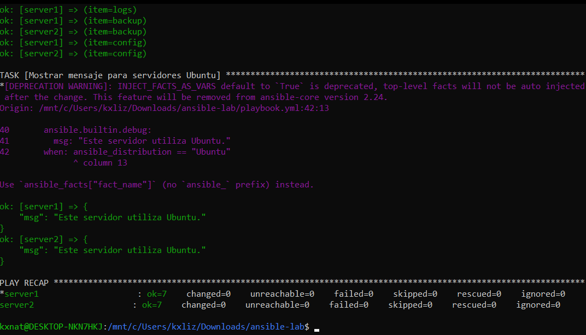

# Laboratorio de Ansible utilizando Docker

## Objetivo

Poner en funcionamiento dos servidores Ubuntu 24.04 mediante Docker y gestionarlos con Ansible. Durante la práctica se consulta la información de cada servidor y se automatiza la creación de archivos y directorios, utilizando un ciclo y una condición.

## Requisitos

- Docker Desktop en ejecución.
- Ubuntu en WSL con acceso a Docker.
- Ansible y Docker Compose.
- Colección `community.docker` de Ansible.

Instalar la colección necesaria:

```bash
ansible-galaxy collection install community.docker
```

## Iniciar los servidores

Desde la carpeta `ansible-lab`, ejecutar:

```bash
docker compose up -d
```

Verificar que los dos contenedores estén activos:

```bash
docker ps
```

## Preparar los servidores

Instalar Python 3 en cada contenedor:

```bash
docker exec server1 bash -c "apt-get update && apt-get install -y python3"
docker exec server2 bash -c "apt-get update && apt-get install -y python3"
```

## Probar la conexión

Comprobar que Ansible pueda comunicarse con ambos servidores:

```bash
ansible docker -i inventory.ini -m ping
```

Los dos servidores deben responder con `SUCCESS` y `pong`.

## Ejecutar el Playbook

Ejecutar el archivo `playbook.yml`:

```bash
ansible-playbook -i inventory.ini playbook.yml
```

## Actividades realizadas

El Playbook realiza las siguientes tareas en `server1` y `server2`:

- Muestra el nombre del servidor y su sistema operativo.
- Crea el directorio `/tmp/ansible-demo`.
- Genera el archivo `info.txt` con el nombre del servidor y la versión de Ubuntu.
- Crea los directorios `logs`, `backup` y `config` mediante un `loop`.
- Muestra un mensaje cuando detecta que el sistema operativo es Ubuntu.

## Evidencia de ejecución


